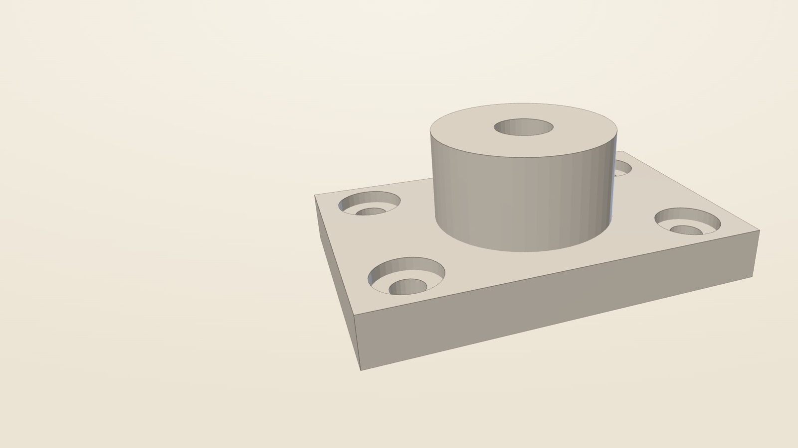
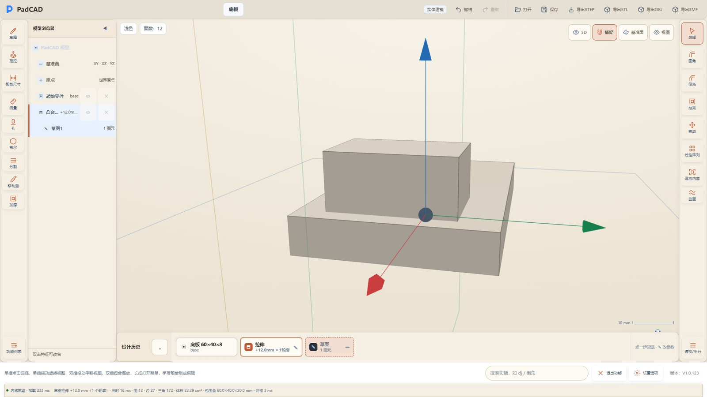
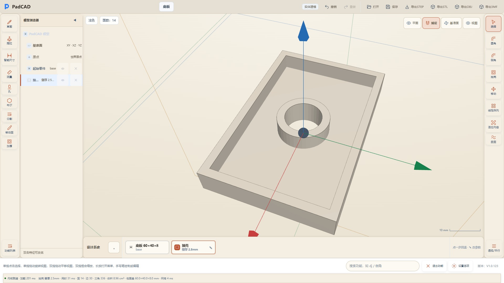
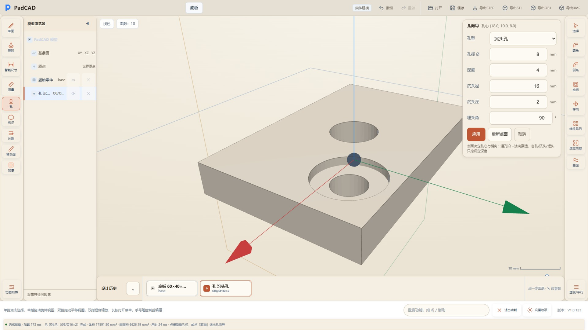
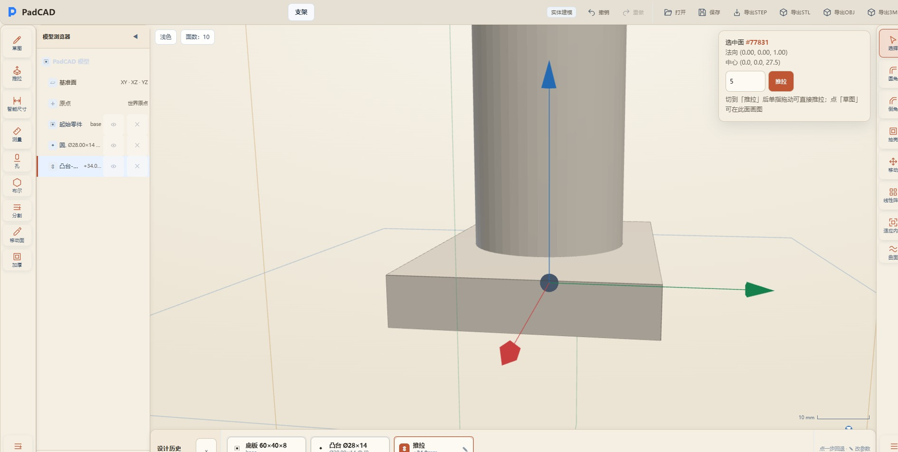

# PadCAD

> 装在平板上的直接建模器：手指在屏幕上拖，几何就长出来；最后能直接导出 STEP 去加工。



PadCAD 是一个跑在浏览器／安卓 WebView 里的 **触摸优先 CAD**。几何内核是编译成 WebAssembly 的
OpenCASCADE（经 [`replicad`](https://github.com/sgenoud/replicad) 封装），渲染用 three.js，
**全部在设备本地算**——不联网、不上传模型、不依赖服务器。

它想解决的不是"把桌面 CAD 缩到平板上"，而是把建模动作改成手能做的动作：
点一个面往上拖就是拉伸，选一条棱拖出去就是圆角，两个面一点就是距离；
改历史里的一个数字，下游特征自动重建。没有命令行、没有对话框树、没有必须先画草图的仪式。

APK 打包走 Capacitor，在小米 Pad 7 Pro/Ultra 这类 12 寸平板上是真的能用的（本仓库就是它的源码）。

## 下载 APK（安卓平板）

**最新版：[PadCAD-5.0.2.apk](https://github.com/timevisitor/padcad/releases/latest/download/PadCAD-5.0.2.apk)**（约 10.9 MB）

- 要求：Android 7.0+（`minSdk 24`），横屏使用；无反编译库，arm64/armv7/x86 通用
- 安装：允许"安装未知来源应用"→ 直接装；首次进建模会加载 22MB 内核，约 1–3 秒
- 签名：本仓库的发布包用 debug 证书签名（方便自用升级），**不适合上架应用商店**；要正式分发请自己生成 keystore 签
- 校验：`sha256 = 34524a2fa3454238536f146579e46e3b3e26c42050a78e0d2a7f5f218100ddc7`

> 国内直连 GitHub release 的下载可能很慢或中断，可以用镜像前缀：
> `https://ghfast.top/` + 上面的下载地址（例：`https://ghfast.top/https://github.com/timevisitor/padcad/releases/latest/download/PadCAD-5.0.2.apk`）。
> 镜像只是加速，装之前仍建议核一下 sha256。

## 能做什么

| 类别 | 能力 |
|---|---|
| 草图 | 矩形 / 圆 / 直线 / 自由折线 / 多边形 / 槽口 / 三点圆弧 / 椭圆 / 裁剪 / 等距 / 转换实体引用 / 镜像与阵列 |
| 特征 | 拉伸（加料/挖料/多轮廓）、旋转、扫掠、放样、圆角、倒角、抽壳、孔向导（通孔/盲孔/沉头/埋头） |
| 实体 | 布尔（并/差/交）、平面分割、移动面、加厚 |
| 曲面 | 曲面偏移、缝合、补面、曲面加厚 |
| 参数化 | 历史特征树、参数编辑与重放、智能尺寸（点两个面设距离，自动反解到上游特征）、撤销/重做 |
| 检查 | 质量属性（体积/面积/质心/包围盒）、两面距离、干涉检查、任意高度截面 |
| 参考几何 | 世界基准面与偏移基准面、参考轴/点/坐标系 |
| 输入输出 | 导出 STEP / STL / OBJ / 3MF；看图模式导入 STEP / STL / PLY / OBJ；工程保存与打开 |
| 扩展 | 建模脚本通道（纯 JSON，逐步重放 + 每步几何断言），可被外部程序/AI 直接驱动 |

## 截图

| 草图 → 拉伸 | 抽壳 |
|---|---|
|  |  |

| 孔向导 | 改历史参数 |
|---|---|
|  |  |

## 快速开始（网页版）

需要 Node 18+。

```bash
git clone https://github.com/timevisitor/padcad.git
cd padcad
npm install          # postinstall 会把 22MB 的几何内核拷到 public/
npm run dev          # http://localhost:5173
npm test             # 212 项回归（真实 OCCT 计算，不依赖浏览器）
npm run build        # 产出 dist/
```

平板上访问 `http://<你的电脑局域网IP>:5173` 就能用（Windows 上放行 5173 端口的入站规则）。

> 几何内核 `public/replicad_single.wasm` 不进仓库，由 `npm install` 时的
> `scripts/copy-wasm.mjs` 从 `node_modules/replicad-opencascadejs` 拷过来。首次打开页面要加载这 22MB，通常 1~3 秒。

## 打 APK

```bash
npm run build
npx cap sync android
cd android && ./gradlew assembleDebug     # 需要 Android SDK 与 JDK 21
# 产物：android/app/build/outputs/apk/debug/app-debug.apk
```

`capacitor.config.json` 里 `webContentsDebuggingEnabled` 默认关闭；调试时可以打开。

## 架构

```
src/kernel.js         OCCT wasm 加载 + 网格提取（面 ID ↔ 三角形映射）
src/ops.js            建模操作（推拉、圆角、抽壳、孔、面信息…）
src/replay.js         参数化重放：从起始零件重算历史链，每步可回填
src/viewer.js         three.js 视口（Z-up，面高亮、拾取、预览线框）
src/camera.js         触摸轨道相机（单指旋转/平面平移、双指缩放平移、长按菜单）
src/sketch*.js        草图会话、图元、约束求解器、捕捉与追踪
src/solid-features.js 分割 / 布尔 / 移动面 / 加厚
src/surface.js        曲面四件套
src/inspect.js        质量属性、距离、干涉、截面
src/exporters.js      STEP / STL / OBJ / 3MF 导出
src/importers.js      STEP / STL / PLY / OBJ 导入（看图模式）
src/main.js           UI 组装与交互状态机（最大的一块，正在解耦）
regression-*.mjs      212 项无头回归（node:test，真实几何断言）
```

设计上的两个硬约定：

- **Z-up**。CAD 惯例是模型躺在 XY 平面、Z 是高度，摄像机与光照全部按这个来，不做坐标转换。
  这条改错的话所有方向性交互（推拉方向、拖动灵敏度）都会歪，而且不报任何错。
- **面引用不跨操作复用**。每次操作都用 `faceId` 重新解析面；持有 OCCT 对象跨两次布尔运算必然
  "object has been deleted"。

## 建模脚本通道

模型可以写成纯 JSON，逐步重放，每步可带期望值做几何断言（失败不动当前模型）：

```json
{
  "v": 1, "name": "带沉头孔的底板",
  "steps": [
    { "op": { "type": "base" }, "label": "底板 60×40×8" },
    { "op": { "type": "hole", "at": [18, 10, 8], "normal": [0, 0, 1],
              "diameter": 8, "kind": "counterbore", "headDiameter": 16, "headDepth": 2 },
      "label": "沉头孔 Ø8/Ø16×2",
      "expect": { "volume": 17591.5, "tol": 0.5 } }
  ]
}
```

页面里也可以直接调用：`window.__padcad.runScriptJSON(JSON.stringify(script))`。
语法与可用 op 见 [docs/model-script-format.md](docs/model-script-format.md)，示例见 [samples/](samples/)。

## 已知限制

- 面/边的引用还是"解析几何 + 历史参数匹配"，**没有拓扑命名**：复杂布尔之后面分裂/合并时可能认不出来源，
  此时会明确拒绝而不是猜。
- 圆环面/圆锥面没有来源关系（不显示径向手柄），要改只能回历史里改原始特征。
- 改参数没有独立的撤销栈（撤销只能回到历史步骤）。
- 未做：拔模、删除面/替换面、裁切实体、时间线重排/分组、配置与参数表、X_T 读取。
- UI 层 `main.js` 仍然偏大（约 6700 行、大量模块级状态），解耦计划在推进中。

## 许可

本仓库代码以 **AGPL-3.0-or-later** 发布：你可以自由使用、修改、分发，甚至商用；
但**修改后的版本若通过网络提供服务或对外分发，必须同样以 AGPL 开源**（含完整源码）。
这条是为了防止"改一版闭源拿去卖"。完整条款见 [LICENSE](LICENSE)。

依赖与内嵌二进制的许可各自独立（OpenCASCADE 是 LGPL-2.1 + 例外），见
[THIRD_PARTY_LICENSES.md](THIRD_PARTY_LICENSES.md)；分发打包产物时请一并带上该文件。

> 如果你只是拿它建模、或把生成的 STEP/STL 拿去加工——不受任何限制，模型文件是你的。

## 致谢

- [OpenCASCADE](https://dev.opencascade.org/) / [opencascade.js](https://github.com/donalffons/opencascade.js) / [replicad](https://github.com/sgenoud/replicad)——几何内核
- [three.js](https://threejs.org/)——渲染
- [Capacitor](https://capacitorjs.com/)——打包安卓
- 交互与 UI 参考了 [Chili3D](https://github.com/xiangechen/chili3d)（AGPL）、[JSketcher](https://github.com/xibyte/jsketcher)（MIT）、
  [SolidCraft](https://github.com/tangency-labs/solidcraft)（MIT/Apache-2.0）等公开项目的**思路与规格**；
  本仓库不含它们的代码。
